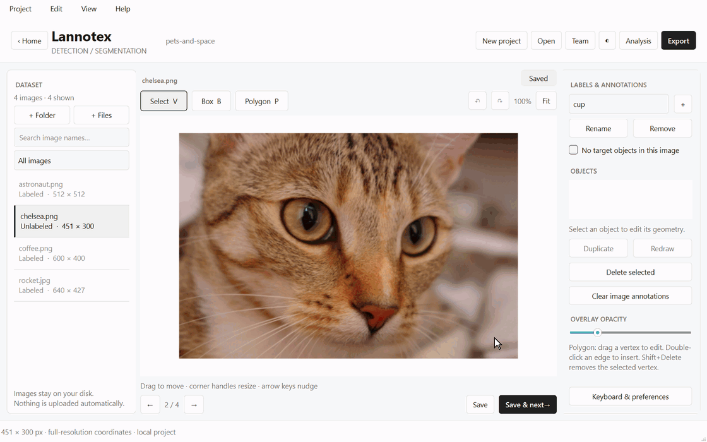

---
hide:
  - navigation
---

# Lannotex

**Label images for AI, on your own machine. Free, offline, MIT.**

Lannotex is a desktop annotation tool for bounding boxes, polygons and image classes. A project
is one SQLite file in a folder you choose, and your source images are never moved, copied or
altered. There is no account, no telemetry, and no network traffic unless you deliberately host
or join a team.

[Install Lannotex](getting-started/installation.md){ .md-button .md-button--primary }
[Coming from LabelMe?](migrate-from-labelme.md){ .md-button }

## Why this one

-   :material-flash:{ .lg .middle } **It stays quick on dense images**

    ---

    Editing costs the shape you touched, not the size of the document. An image with 200 shapes
    used to freeze for six seconds on every mouse release; the same edit now takes 0.2 ms. CI
    fails the build if an edit ever exceeds 16 ms.

-   :material-image-size-select-large:{ .lg .middle } **Image size stops mattering**

    ---

    Zooming past the preview builds a tile pyramid once and caches it. A 900 MP TIFF reopens in
    0.1 s and pans using under 200 MB — the whole image would need 2.7 GB to decode.

-   :material-shield-check:{ .lg .middle } **You don't lose work**

    ---

    Every edit is written to a recovery draft within 250 ms, saves are transactional, and undo
    history survives a crash. Invalid geometry is refused before it reaches your dataset.

-   :material-swap-horizontal:{ .lg .middle } **It speaks the formats you already use**

    ---

    Import LabelMe, COCO, YOLO and Pascal VOC. Export all of those plus CSV and a lossless
    JSONL, with a reproducible train/val/test split — all free.

## At a glance

| | |
| --- | --- |
| **Annotate** | Bounding boxes, polygons, multi-label image classes, explicit "no targets" |
| **Pipelines** | Classification, detection, segmentation, or all three — each shows only its own tools |
| **Images** | JPEG, PNG, WebP, TIFF, BigTIFF, BMP, including 16-bit |
| **Export** | Labelme JSON, YOLO boxes, YOLO segments, Pascal VOC, COCO JSON, classification CSV, native JSONL |
| **Import** | LabelMe, COCO, YOLO, Pascal VOC, native JSONL — detected automatically |
| **Automate** | `lannotex export`, `import` and `analyze` run headless, with no display |
| **Platforms** | Windows, macOS, Linux · Python 3.11–3.14, or a standalone build |
| **Licence** | MIT |

## Where to go next

- **New here?** [Quick start](getting-started/quickstart.md) takes you from a folder of images
  to an exported dataset.
- **Moving a dataset in?** [Coming from LabelMe](migrate-from-labelme.md), or
  [Import & export](guide/import-export.md) for COCO, YOLO and VOC.
- **Something not working?** [Troubleshooting](guide/troubleshooting.md).
- **Automating?** The [command line reference](cli.md).
- **Changing the code?** [Architecture](reference/architecture.md).
